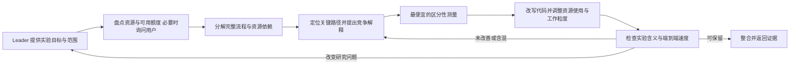

# Research Pi：实验系统优化 Agent 设计

调研日期：2026-10-27。状态：设计依据保留；当前分支已实现内置 skill 和与 executor 平级的 `systems-optimizer` 角色，模型设置与权限接入见 `docs/configuration.md`。尚未进行真实 GPU 性能实验。

**核心建议：增加一个从系统层面优化实验代码的 executor mission，配套 `experiment-systems-optimization` skill。它先了解目标环境实际可用、允许使用的资源，必要时直接向用户询问，再分解完整实验的计算、数据流和依赖，定位限制端到端速度的环节。在充分利用已分配资源的前提下，选择 CPU、内存、I/O、进程调度、CPU–GPU 通信或 GPU 侧的干预，以更快获得同等有效的实验结果为目标。**

用户补充已纳入：Research Pi 主要面向使用 GPU 的实验，但优化对象是整个实验系统。CPU 上的计算、数据组织以及 CPU–GPU 通信都可能是主要瓶颈。这里 SGLang、vLLM 代表公开、现成、成熟的库函数，而不专指推理框架：其内部实现通常已有较充分优化与验证，对这些内部实现的优化优先级最低。重点先放在我们编写的实验代码，包括如何调用、组合和向这些库供给数据。不能因为实验使用 GPU 就预设瓶颈在 GPU。

## 1. 调研发现：可复用部件已经存在，完整职责仍需由 Pi 组织

完整工具调研见 [现有工具记录](gpu-infra-existing-tools-research.md)。此前检索集中在 GPU/训练性能生态，属于本系统方案的部分参考，不是 CPU、I/O 与通用系统性能工具的完整调研。下表是针对本设计的取舍；“建议借鉴”不代表已经验证其能加速我们的代码。

| 来源 | 已有能力 | 建议借鉴与适用边界 |
| --- | --- | --- |
| [NVIDIA MoE optimization workflow](https://github.com/NVIDIA/skills/blob/main/skills/nemo-mbridge-perf-moe-optimization-workflow/SKILL.md) | 先固定比较条件，再判断显存、通信、host/launch 或计算瓶颈，执行短程筛选与实测验证 | 借鉴证据驱动迭代、区分训练等价与仅供 benchmark 的改动。它依赖 Megatron Bridge/MoE 语境，不作为所有 GPU 实验的总入口 |
| [TorchTitan inference hill-climbing](https://github.com/pytorch/torchtitan/blob/main/torchtitan/rl/.claude/skills/inference_perf_hillclimb/SKILL.md) | 对固定工作负载比较实现差距，定位 host lag、capture coverage、rank 到达偏差等 | 借鉴“瓶颈可能在上游代码”“profile 改善须经真实吞吐确认”。其 benchmark 依赖专门分支、临时分析脚本和特定模型配置，不能直接安装后泛用；也不要把 collective 最短时长当成普适纯通信估计 |
| [TorchTitan local compile](https://github.com/pytorch/torchtitan/blob/main/.claude/skills/local_compile_perf/SKILL.md) | 找到慢的 glue operations，重写或重组为编译器可优化的区域，考虑冷编译、graph 数量和数值行为 | 适合“实验层问题清理后，仍有小算子/host overhead”的分支。不要照搬其全面测试、逐项提交和文档流程 |
| [TensorRT-LLM performance coordination](https://github.com/NVIDIA/TensorRT-LLM/blob/main/.claude/skills/perf-optimization/SKILL.md) | 协调优化、profiling 和 kernel 专家，按结果迭代 | 借鉴测量反馈与候选排序。其分工偏 kernel/CUDA Graph，逐次备份及多专家拆分不适合直接成为 Pi 默认流程 |
| [NVIDIA DeepStream profiling](https://github.com/NVIDIA/DeepStream/blob/main/skills/deepstream-profile-pipeline/SKILL.md) | 测量 batch 吞吐平台点，再分析端到端流水线 | 借鉴“先找合适工作粒度，再组织流水线”。它的降低精度、改变输出分支等默认策略不能带进任意科研实验；microbenchmark 也不等于完整实验结果 |
| [K-Dense optimize-for-gpu](https://github.com/K-Dense-AI/scientific-agent-skills/blob/main/skills/optimize-for-gpu/SKILL.md) | 科学 Python 的 GPU 化，重视数据驻留、现有数值库和端到端正确计时 | 可作科学计算参考。重点包含 CPU→GPU 移植；我们的默认问题还包括已在 GPU 上、却以低效方式组织的实验 |
| [AMD Primus Tuning Agent](https://rocm.docs.amd.com/projects/primus/en/v26.8/02-user-guide/tuning-agent.html) | 在支持的训练栈中搜索 batch、并行划分、调度、重计算及通信参数 | 是接近完整 agent 的训练配置优化设计。借鉴把候选生成、合法性判断和 evaluator 分开；模拟/投影的最优配置必须经实机确认，不能覆盖任意上层实验代码重构 |
| [HTA](https://docs.pytorch.org/tutorials/beginner/hta_intro_tutorial.html)、[TraceLens Agent](https://github.com/AMD-AGI/TraceLens/tree/main/TraceLens/Agent/Analysis) | 从 trace 识别空闲、host wait、通信重叠和 rank 差异，并生成分析或建议 | 作为测量和归因组件，不能代替对实验语义、重复工作及替代计算方式的理解；TraceLens 的系统层建议仍有 experimental 标记 |

另外，[Nsight AI](https://developer.nvidia.com/nsight-ai) 的 CUDA MCP 主要提供知识检索，Nsight Compute Copilot 聚焦 kernel；[KernelAgent](https://github.com/meta-pytorch/KernelAgent) 也主要针对 kernel。它们可作为后续专家能力，不作为本 agent 的中心。

发现渠道包括 skills.sh、`npx skills find`、官方仓库原文及工具文档。2026-10-27 查询时，[NVIDIA 对应 skill](https://www.skills.sh/nvidia/skills/nemo-mbridge-perf-moe-optimization-workflow) 显示约 1.8K 安装，NVIDIA/skills API 返回 3,756 stars；TorchTitan 仓库 5,855 stars，但 CLI 返回 inference skill 仅 5 installs；TensorRT-LLM 仓库 14,960 stars。仓库热度不能证明其中某个 skill 的可靠性，以上选择主要依据一手内容与任务匹配。K-Dense 单项安装数未确认。

若之后只想试读 NVIDIA 训练分支，可用其目录给出的安装方式；本次没有执行安装：

```bash
npx skills add https://github.com/nvidia/skills --skill nemo-mbridge-perf-moe-optimization-workflow
```

**调研结论是应组装已有知识与测量工具，而不是照搬一个外部通用 agent。** 本次核查未发现能直接覆盖任意 GPU 科研脚本、自动完成等价改写并验证完整实验收益的成熟即用方案；这不构成对所有未检索项目的不存在声明。

## 2. 职责：先分解系统问题，再找到更省工作、更少等待的实现

建议名称：**Experiment Systems Optimizer**，中文“实验系统优化代理”。界面上作为与 executor 平级的 `systems-optimizer` 角色出现，有独立模型设置，执行权限沿用 executor。GPU 实验是主要应用场景，名称和入口流程不预设优化设备。

它接收实验目标、入口、代表性输入和已有约束，输出以下三种有用结果之一：

1. 已验证更快的实验实现，连同适用范围和完整实验速度变化。
2. 当前瓶颈被定位，某种优化方向被证据排除或留下明确下一步。
3. 发现更快的算法/估计方式，但其改变了研究含义；把它作为新实验方向交给 Leader，而不混入原实现的性能成绩。

先确定资源范围，再把完整实验拆成有依赖关系的阶段：输入读取、CPU 预处理/仿真、任务构造与排队、数据传输、设备计算、CPU 后处理、汇总/保存。标记各阶段执行次数、数据规模、资源、等待和可重叠关系；只展开与当前问题有关的部分。以实际关键路径和流水线供给约束判断优化位置，不直接把各阶段耗时相加，也不把占用率低的设备自动认定为瓶颈。

完成这一步后，优先检查以下实验代码问题。CPU 和 GPU 的具体改造根据瓶颈选择，无需固定谁先谁后；成熟库内部的优化放在最后。

| 层次 | 核心问题 | 常见改造 |
| --- | --- | --- |
| A. 实验计算方式 | 是否在做不必要的工作？是否存在更高效的等价表达？ | 消除重复 forward/特征提取；不变项外提；精确复用中间结果；广播、分块计算、直接统计充分量；取消仅为中间格式而进行的转换 |
| B. CPU 计算与代码组织 | Python 循环、对象操作、预处理或后处理是否主导？是否串行执行独立工作或反复初始化？ | 更好的算法/数据结构、CPU 批量计算、不变项复用、常驻 worker；按任务性质选择线程/进程，测量序列化与 IPC 成本 |
| C. 数据移动与流水线 | 哪个阶段在等谁？是否反复复制、转换、传输或受到队列阻塞？ | 减少 CPU 内存复制和格式转换；合并 IPC/H2D/D2H 传输；调整数据驻留位置；按瓶颈安排预取、重叠和结果处理 |
| D. 设备计算与任务粒度 | 当 GPU 计算或提交确实限制系统时，调用形状与组织方式是否合理？ | 跨样本/候选合批、分块、向量化；适合时使用编译/graph；调整实验侧并行组织 |
| E. 成熟库内部专项 | 排除调用方式与上游影响后，库内部是否仍有明确、重要的改进空间？ | 仅凭直接证据再考虑库内部代码、底层算子或框架替换，优先级最低 |

A 层中的“替代”既可以是更高效的等价算法/计算表达，也可以是用现有批量 API 替代实验代码中的手写循环。**合理使用成熟库与优化成熟库内部必须区分。** 前者属于实验代码优化；后者优先级最低。某个库调用耗时长，也可能是我们调用次数过多、输入组织不当或在该处等待此前异步工作，不能仅凭函数耗时榜就归因于库内部低效。CPU 路径能高效完成的工作也不必迁到 GPU；收益须计入传输和准备成本。

**代码精简是重要收益，但不作为硬性行数目标。** 用张量批处理替代手写循环往往同时提高速度和可读性；少量有用预取代码增加行数也可能值得保留。收益相近时优先选择更简单、依赖更少、启动成本更低的实现。

### 资源意识：不要继承代码中未经审视的小资源假设

优化开始时，主动确认目标执行环境，而不是只查看运行 Pi 的本机。已有任务上下文、调度器分配和可读状态能给出的信息直接使用；机器/额度未知或会改变方案时，直接向用户询问。区分机器总容量、当前可用容量与本实验可使用的额度；共享机器上空闲不等于已分配，已知授权也无需反复确认。

| 资源或约束 | 需要了解什么 | 如何影响候选方案 |
| --- | --- | --- |
| CPU | 分配的核心/线程数、当前竞争、允许的进程数 | CPU 计算并行度、worker 数及每个 worker 的线程数 |
| 主内存 | 可用容量、任务/容器额度、其他作业占用 | 数据预加载、特征缓存、批量构造、共享数据与预取深度 |
| GPU | 可用卡数、型号、每卡显存及占用、共享/独占情况 | microbatch、分块大小、驻留数据、多实验并发和多卡分片 |
| 存储与连接 | 本地临时空间、数据位置，必要时了解磁盘/网络/卡间连接 | 本地缓存、读取方式、跨进程/设备的数据安排 |
| 时间与成本 | 可占用多久、是否优先缩短墙钟、是否有核时/GPU-hours/费用上限 | 配置搜索与完整实验的资源分配、是否值得扩展并发 |

可向用户一次性问：**“这次实验可以使用哪台机器或哪个分配？大约可用多少 CPU 核、内存、几张 GPU 和每卡显存，是否独占？在这些额度内是否优先缩短完成时间，还是另有成本上限？”** 只问尚缺且会影响选择的部分。答案到达前可继续读代码和分析资源需求，不把未知额度默认为无限，也不默认为只能用极小资源。

在确认的资源范围内，默认积极利用资源换取实验速度。当前的 batch=1、单 worker、小缓存或逐条落盘只是已有配置，不能自动当成真实约束。检查它们来自实际容量限制、算法含义，还是历史遗留的保守默认值。batch 是配置变量，能增大到哪里取决于资源、数据形状和实验语义。

按瓶颈选择少量资源扩展试验，例如增加 CPU 并行度、将反复读取的数据预载入内存、扩大批量/分块、让复用数据常驻显存、增加独立实验并发。可从当前点逐级扩大，在吞吐收益趋平、资源边界或语义边界处停下；只有显示出相互制约时才联合搜索 batch、worker 与预取深度。不要默认扫完整组合，也不要把压低内存/显存占用作为目标。

估计容量时计入中间量、每个 worker 的数据副本、队列和变长输入的峰值，保留与实际波动相符的余量；没有必要统一套一个很大的保守比例。追求有效吞吐，不要求把所有资源填满。新增资源没有改善关键路径时，应停止扩展并重新诊断。

## 3. 优化闭环：代码理解、廉价探针和短程实验结合



**第零步：确定资源条件。** 获取目标机器/分配的 CPU、内存、GPU/显存及时间/成本范围，必要时直接询问用户。明确哪些是硬约束，哪些只是代码的保守默认；已有信息足够时直接推进。

**第一步：恢复实际工作并做系统分解。** 找出一次完整实验到底做什么：样本/候选/seed 数量、依赖关系、重复调用、模型和缓存生命周期、输入输出以及计算结果如何被评价。先用代码和已有阶段计时了解 CPU、内存、I/O、IPC、设备传输与计算如何串联/重叠，以及队列在哪里饥饿或积压。第一份有用判断应说明“在可用资源下哪个阶段限制完整实验、是否存在未利用的容量、依据是什么、还缺什么区分性观察”，不必先生成 GPU kernel 排名或完整监控报告。

**第二步：形成少量有区别的解释。** 例如同样是低吞吐，可能来自 CPU 算法低效、重复工作、内存复制、I/O、进程间序列化、队列阻塞、CPU–GPU 往返，或确实昂贵的设备计算。至少考虑一个改变当前计算组织方式的候选，而不只微调已有参数。不能从 GPU 空闲直接跳到“增大 GPU batch”。

**第三步：用最便宜的探针区分。** 先复用现有计时和日志；必要时加调用次数、阶段/队列等待计时。CPU 计算问题按需用 CPU 采样或局部计时，IPC/I/O 问题看相应等待和数据量；需要定位异步等待或跨设备关系时，再采集短的 PyTorch/Nsight trace。静态代码足以发现明显重复工作时，可直接做小规模对比验证，不强制每次完整 profiling。

| 竞争解释 | 有区分力的探针 | 观察如何影响下一步 |
| --- | --- | --- |
| 历史小资源默认限制吞吐 | 在已分配资源内扩大 batch/分块、缓存或 worker 中与瓶颈相关的一项，比较完成时间与峰值资源 | 若明显改善，修正资源配置假设并寻找适合当前资源的运行点；不要过早进入库内部优化 |
| 固定开销/初始化主导 | 记录初始化次数；常驻同一模型重复处理同一规模任务 | 若初始化占主要耗时，先改生命周期；扩大 batch 不是唯一解 |
| CPU 或 I/O 供给不足 | 在代表性子集上预先准备输入，再与真实输入路径对比 | 差距大则优化供给；预制输入仅用于诊断，不计为最终加速 |
| CPU 算法/数据结构低效 | 固定输入比较局部实现，观察调用次数与 CPU 时间；必要时采样 | 优先减少工作或改为批量处理；不先增加 worker 掩盖低效算法 |
| IPC/序列化或进程管理主导 | 比较任务粒度、传递数据量和常驻 worker 的成本；只传索引/句柄作诊断 | 若传输/调度成本吞掉计算收益，合并任务、减少复制或改回更简单的执行方式 |
| CPU–GPU 数据往返主导 | 记录传输次数、字节与等待；将必要中间量暂时驻留一侧做对比 | 优先减少跨设备边界与同步；是否搬动计算取决于包含准备/传输的总成本 |
| CPU 后处理/汇总主导 | 保持同一计算输出，单独计时结果整理和保存，并观察队列积压 | 优化后处理算法、批量汇总或与下一批重叠；不能只优化 GPU 输入端 |
| 小 batch/launch 主导 | 同等总工作量下比较逐条与分块打包，测显存与端到端时间 | 有收益则寻找吞吐平台附近的工作粒度；避免无界增大 batch |
| 冗余计算主导 | 统计同一不变输入/模型状态的重复处理；临时复用中间量 | 验证复用是否合法，再消除重复；数据增强、模型更新会改变可复用范围 |
| 分布式等待主导 | 比较各 rank 输入就绪、计算结束和 collective 到达时间 | 先区分上游慢 rank 与实际通信；不能见长 NCCL 就调通信库 |
| 实际计算已主导 | 与同形状批量实现或已知合理基线对比 | 若外层开销占比已小，停止增加并发；再决定是否进入框架/kernel 分支 |

**第四步：改一个机制清楚的候选，必要时检查交互。** 不是强制“一次只改一行/一个参数”。例如消除逐样本同步和批量 GPU 调用可能需要一起重写整段循环。若单独增加 batch、worker 都无效，但两者可能相互制约，可用小型 2×2 对比判断，避免逐次小补丁错过结构性收益。

**第五步：以有效工作和完整时间作决定。** 没收益就分类：机制未生效、测量不可解释，还是机制生效但没有价值。前两者修复到可解释即可；第三种允许直接结束该方向，不必继续寻找“补丁”。

## 4. 多 batch、多进程、多实验必须区分

这些都是候选手段，不是 agent 的固定答案。

| 手段 | 适合的情况 | 关键约束 |
| --- | --- | --- |
| 单 GPU 进程 + 批量张量计算 | 同一模型/操作处理许多独立样本、候选或环境 | 用 shape bucket、分块、`vmap` 等；保持输入输出 ID、边界和随机性要求 |
| CPU 多进程 + 少量 GPU owner | 解码、仿真、特征准备等 CPU 阶段拖慢 GPU | 实测 worker 数和队列长度；不让每个 worker 重复持有模型、无界堆积输入 |
| 多 GPU 分片独立实验 | 不同 seed、配置、样本子集之间无依赖 | 比较整批实验的完成时间与 GPU-hours；汇总时保留独立 run 身份 |
| 同 GPU 多进程并行 | 单任务不足以饱和 GPU，且合批不可行 | 额外显存、上下文和资源竞争可能抵消收益；MPS 仅在适用环境下成为候选 |
| 异步训练/rollout 流水线 | 存在可重叠阶段，且研究允许数据/策略滞后 | 队列深度和 policy lag 可能改变算法；不能默认为原算法的纯 infra 优化 |

例如一张 GPU 上的很多小独立模型，可能适合沿“模型/实验轴”向量化；这要求各模型参数、optimizer state 和随机流仍独立。不能把它们合成一个共享参数模型，再声称原实验加速了。时间上相互依赖的仿真步也不能当作独立 batch。

[PyTorch vmap](https://docs.pytorch.org/docs/stable/generated/torch.vmap.html) 提供函数的批量变换，但有[副作用和随机性限制](https://docs.pytorch.org/docs/2.14/func.ux_limitations.html)。[NVIDIA MPS](https://docs.nvidia.com/deploy/mps/when-to-use-mps.html) 针对单进程不能充分使用 GPU 的情况，不能据此推出任意多进程都会更快。数据 worker 和同步点可参考 [PyTorch tuning guide](https://docs.pytorch.org/tutorials/recipes/recipes/tuning_guide.html)。

## 5. 指标与实验含义：只检查会改变判断的事项

主指标按任务选择：固定有效样本/候选/实验集合的完成墙钟；训练达到目标质量所需时间。辅助指标按实际瓶颈选择：有效吞吐、CPU 时间/核数、主内存峰值、IPC/I/O/设备传输量与等待、GPU-hours 和峰值显存，不要求每次全部采集。增加 CPU 资源可能值得，但须交代换来了多少端到端收益。

报告基线与候选各自可用及实际使用的资源。既允许同一资源额度内更充分利用容量，也允许在用户许可下用更多资源换墙钟；增加卡数/核数取得的收益应明确为资源扩展或调度收益，不冒充同资源下的实现效率提升。为当前决策有必要时，再分别测量代码改写与资源扩展的贡献，不强制每次额外做一套消融。

GPU utilization、GPU 空闲比例、kernel 数量和通信重叠用于解释机制，不单独作为成功标准。[nvidia-smi 的 GPU utilization](https://docs.nvidia.com/deploy/nvidia-smi/index.html) 是采样窗口内存在 kernel 执行的时间比例，不能直接等同于有效算力利用率。持续忙碌也可能是在等待、冗余计算或做无效工作。

如计算 trace 空闲比例，先注明窗口、GPU、目标进程，以及 compute/communication/copy 活动的覆盖范围，再对时间区间取并集。不要把并发 kernel 时长相加当作 wall time；存在 GPU activity 也不代表没有流水线气泡或通信等待。

最低有效性检查随干预变化：

- **合批/重排评测：** 同一数据集合与输出映射，不能漏掉尾 batch；必要时对实际评分结果进行对比。
- **缓存/预计算：** 模型参数、输入、增强和随机变量是否保持不变；不能意外跨训练/验证边界复用不该复用的信息。
- **数值改写：** 在有代表性的输入上按任务允许的误差比较输出；阈值附近的排序、决策或指标可能比平均误差更关键。
- **训练 microbatch 改造：** 保持目标 effective batch、梯度归一化和更新频率；即使 global batch 相同，BatchNorm、batch 内负样本、dropout/RNG 与样本排序仍可能影响语义。短程输出/梯度或 loss 检查不证明长期收敛。
- **更换精度、近似算法、截断长度、减少候选或引入异步策略滞后：** 属于可能改变科学结论的干预，须单独说明质量与成本取舍。不能作为“同等工作更快”的默认结果。

计时使用未开启 profiler 的代表性执行；profile 用于解释。异步 GPU 工作应在测量窗口边界正确等待完成，不在每个小算子后加同步破坏原流水线。多 GPU 同时报告实际进程级端到端完成时间，单 rank CUDA event 不代表整个实验。

同时报告冷启动总成本与稳态速度。对于短实验，JIT/graph capture、worker 启动、重新加载和迁移成本可能吃掉收益。令额外准备成本为 C，原每单位有效工作时间为 t0，优化后为 t1，则粗略回本工作量为 `C / (t0 - t1)`，仅在 t0 > t1 且单位工作可比时有意义。预期剩余工作量不足以回本，通常就不值得继续。

不规定一律跑 50 步、多个 seed 或完整测试矩阵。用足以改变当前决策的短程检查；收益接近噪声时再增加交错 A/B 或重复。优化累计效果最终对原始 baseline 测一次，不把各阶段加速比机械相乘。

## 6. 接入 Research Pi：复用调度，按需测量目标实验系统

以下是对当前工作树的只读检查结果，非已发布版本保证：

| 现有位置 | 已有能力 | 本设计如何使用 |
| --- | --- | --- |
| `.pi/extensions/codex-delegate.ts` | 角色为 advisor/executor/systems-optimizer/environment/general；有 task、mission、context、successCriteria、writeScope、resourceClaims、experiment | 使用 systems-optimizer 与稳定 mission；独立角色配置复用 executor 执行模式，无需新 backend |
| `.pi/lib/runtime-subagents.mjs` | 复用已有 mission/Actor、继续任务与消息传递 | 让同一优化任务保留必要上下文；无需每轮启动一整套代理 |
| `.pi/extensions/record-experiment.ts` | 已有 decision-changing 结果的轻量记录 | 只记录值得保留的性能发现及无效实验原因；普通探针不另造报告 |
| `.pi/lib/runtime-performance.mjs` | Pi 进程 CPU、RSS、event loop 和内部 counters | 它测的是 Pi 自身，不代表目标实验进程的 CPU、I/O 或 GPU 性能 |
| `bin/pi.mjs` | 显式加载内置 skill 和 `config.resources.skills` | 新 skill 需加入加载路径或资源配置；只把文件放进 `.pi/skills` 不等于所有 runner 自动可用 |

首次落地建议包含：

1. `.pi/skills/experiment-systems-optimization/SKILL.md`：资源盘点/必要询问、系统分解、关键路径、竞争解释、候选改造与验证的短流程。
2. 同目录 `references/experiment-patterns.md`：CPU 算法、数据结构、重复工作、生命周期、IPC、数据移动、合批与流水线案例，包含何时不适用。
3. `references/measurement.md`：端到端/阶段计时、CPU 与设备采样、等待与重叠解释，以及实验最小语义检查。
4. 先使用目标项目已有 benchmark 和工具。出现重复需求后，再加小型 trace 摘要脚本或测量适配器；不先开发通用性能平台。

当前轻量实现只有核心 SKILL.md，按需参考文件和测量脚本尚未增加。Leader 加载 skill 的描述以供发现；Systems Optimizer 的角色提示直接包含同一文件的正文，覆盖所有 backend 及 Codex 续接，不依赖 worker 跨项目读取安装目录。

示例委派形状如下，路径、GPU 和预算仅为示意，实际由当前实验确定：

```json
{
  "action": "start",
  "role": "systems-optimizer",
  "mission": "systems-optimize:candidate-evaluation",
  "task": "读取实验系统优化 skill。先确认目标环境可用的 CPU、内存、GPU/显存及时间成本额度，缺失时向 Leader 或用户询问；检查已有配置是否过度保守。再分解完整评测流程，定位关键路径，充分利用已分配资源优化实验代码。成熟库内部优化优先级最低。",
  "writeScope": ["src/evaluation", "scripts/evaluate.py"],
  "resourceClaims": ["gpu:allocated-host:0"],
  "successCriteria": [
    "处理同一有效候选集合，保留评分与输入输出对应关系",
    "报告完整评测时间、稳态吞吐、前后资源使用及证据位置",
    "保留有价值的改造，或给出足以结束该方向的诊断结论"
  ],
  "experiment": {
    "question": "哪个阶段限制完整评测：CPU 计算、数据移动/等待、重复工作还是设备计算？",
    "distinguishingOutcomes": [
      "复用不变量后明显下降：重复工作占主导",
      "CPU 局部改写或减少 IPC/设备往返后下降：主机路径/数据移动是重要限制",
      "分块打包后明显下降：任务粒度/调度占主导",
      "两者都未改善且计算占主导：检查核心执行路径"
    ],
    "validityChecks": ["同等有效工作量", "检查候选机制实际生效"],
    "budgetAndStop": "遵守本次分配的墙钟与 GPU 预算；无可解释收益或预期无法回本时停止扩展"
  }
}
```

`resourceClaims` 仅协调使用同一 Pi state store 的任务，不是操作系统或集群锁，也不表达 CPU 核数、主内存和显存的数量配额。第一版通过 task/context 传入已知资源范围并沿用实际调度器限制，不另建资源管理平台。用调度器分配的 GPU/远程工作区，并识别实际运行与归属。多代理可以并行读代码、提候选；同一 GPU 的对照测量不能被无关实验竞争污染。并发本身是被测方案时，则明确把它纳入条件。

Actor 的结束不等于外部训练进程结束。复用现有 externalRuns/资源生命周期；执行预算提示也不等于自动终止远程作业。只停止本任务有权控制的运行。已有授权范围内自主推进，不因普通可逆改写反复询问用户。

## 7. 用真实实验问题验证 agent，而非先扩建架构

首轮挑选现有项目中的少量代表性任务；以下是任务类型建议，并非已存在的测量结果：

| 任务 | 希望检验的能力 | 容易产生的错误结论 |
| --- | --- | --- |
| 资源充足但默认小 batch/少 worker/小缓存 | 主动了解资源额度，识别假约束，找到更快的资源使用方式 | 沿用保守默认，只微调局部代码；或只追求占满内存而没有吞吐收益 |
| 候选打分/离线评测 | 识别逐条 forward、重复分词/特征提取和频繁同步，改为复用与分块打包 | 缩短输出、丢尾 batch 或少算候选后声称加速 |
| CPU 后处理或 IPC 占主导的 GPU 实验 | 从系统分解定位 CPU 算法、对象/序列化成本或结果汇总，改善完整时间 | 仍盯着 GPU 调参；增加 worker 导致额外复制与竞争 |
| Monte Carlo/参数扫描/仿真 | 向量化独立维度、消除重复准备、合理组织 CPU/GPU | 破坏 seed 独立性或时间因果；把近似替代说成等价 |
| 小模型训练/梯度实验 | 识别 microbatch、数据准备与更新之间的瓶颈 | 合并 optimizer 状态、改变有效 batch，混淆吞吐和收敛 |
| 已合理批处理、计算占主导的对照任务 | 得出外层优化空间有限，及时停止 | 为了显得完成工作强行加进程/框架，造成回归 |

在相同模型与时间/算力预算下，对比普通 executor 和携带该 skill 的 executor：看完整任务耗时、优化总成本、改造语义是否有效、是否正确归因以及是否知道停止。探索用例之外保留一个未用于改写 skill 的任务，避免只记住几个模板。初期不要求构建大型 benchmark。

推广标准是：在这些任务上多次产生可解释、值得回本的改进，或能可靠排除无效路线；不是必须每次达到某个倍速。若 skill 已足够，无需新增 harness 代码。若反复缺的是同一种可计算证据，再把那部分升级为工具。

## 8. 建议的 agent 核心指令草案

> 你负责缩短获得有效实验结果的时间，主要面向使用 GPU 的科研实验。首先主动了解目标环境可用且允许使用的 CPU、主内存、GPU/显存、存储以及时间/成本额度；已有信息不足时直接向用户询问。不要把代码中的小 batch、少 worker、小缓存当成既定资源限制。在确认的资源范围内积极利用容量换取实验速度。
>
> 随后理解实验含义，分解完整流程、资源依赖、关键路径与等待；CPU 计算、内存、I/O、进程调度、IPC、CPU–GPU 通信和 GPU 计算均在分析范围内。根据证据选择优化位置，不预设 GPU 是瓶颈。按实际瓶颈测试资源扩展与工作粒度，直到收益趋平或达到真实约束。
>
> 优先优化我们编写的实验代码：更高效的等价计算、算法与数据结构、消除重复工作、减少复制/转换/传输、合理粒度与并发、阶段重叠。成熟公开库函数内部的优化优先级最低；先检查我们如何调用它们。多进程、加 batch、编译和迁移设备都是待验证手段。
>
> 用少量竞争解释和最便宜的区分性测量选候选。可重写阻碍性能的结构，不为最小 diff 保留低效设计。保留输入输出语义、独立实验身份和实际资源归属；改变精度、估计方法或训练含义的方案单独报告。
>
> 以同等有效工作量的端到端时间和所用计算资源判断收益；CPU/GPU utilization 和 profile 只帮助解释。计入启动、准备、数据移动和编译成本，按预期剩余实验量判断是否回本。
>
> 在授权范围内完成修改与必要验证。无收益时识别是干预无效、测量无效还是方向无效；停止低信息补丁循环。只留下会影响后续研究判断的简短记录。

**落地顺序：先实现平级角色 + 专门 mission + 系统分析 skill，在上层实验代码问题上验证价值，再按实际缺口增加测量工具。CPU、数据移动和 GPU 优化由关键路径决定；成熟库内部优化作为最低优先级的专项分支。**
